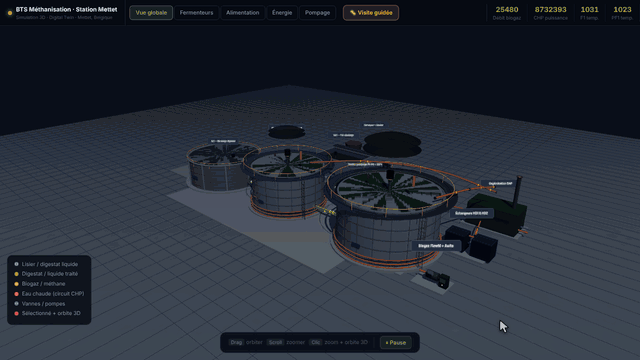

  

# BTS Méthanisation · Station Mettet

Simulation 3D (jumeau numérique) de la station de méthanisation de Mettet, Belgique.
Cliquer sur un équipement zoome dessus, active l'orbite 3D et affiche ses variables temps réel et ses graphiques sur 8 jours.

## Équipements simulés

- Alimentation : convoyeur + Limator
- VG1 : pré-stockage
- Station de pompage : pompes P1 à P4, vannes, séparateur SEP1
- F1 : fermenteur principal
- PF1 : pré-fermenteur
- EL1 : stockage du digestat
- Réseau biogaz et Awite
- Cogénération CHP
- Échangeurs thermiques HD1 et HD2
